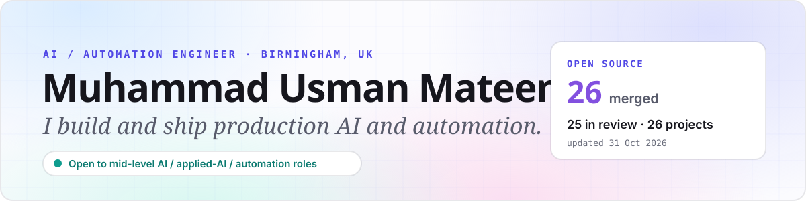
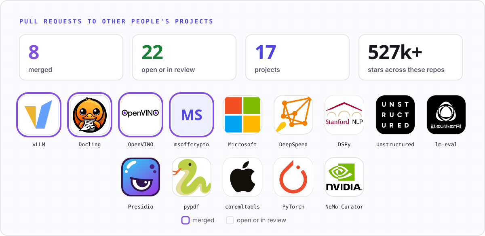
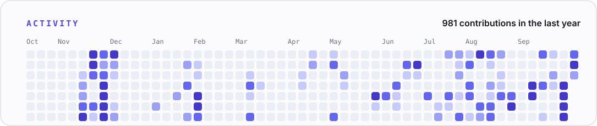

<a href="https://usmanmateen.com">
  <picture>
    <source media="(prefers-color-scheme: dark)" srcset="assets/header-dark.svg">
    
  </picture>
</a>

  
  
  
  

<a href="https://usmanmateen.com">
  <picture>
    <source media="(prefers-color-scheme: dark)" srcset="assets/cards-dark.svg">
    
  </picture>
</a>

I'm a Software Developer at **Energy One**, building enterprise energy-trading (ETRM) systems in Python, C#/.NET and SQL, and I've just submitted my **MSc Applied AI** dissertation at the **University of Warwick (WMG)**: benchmarking hybrid retrieval for enterprise RAG on FinanceBench. I like systems that have to be right: migrations that can't lose a ticket, guardrails that sit in front of an LLM, and converters that have to compute exactly what PyTorch computes.

## Open source

<picture>
  <source media="(prefers-color-scheme: dark)" srcset="assets/open-source-dark.svg">
  
</picture>

I fix bugs I can reproduce, one pull request per bug, each with a minimal repro and a test that fails before the fix. Most of them come from comparing a converter or runtime against eager PyTorch on edge values (NaN, infinities, −0.0, integer overflow), or from feeding real documents to parsers.

<!-- counts:start -->
**8 merged** · 22 open or in review, across 17 projects with 527,710 combined GitHub stars.
<!-- counts:end -->

**Merged**

<!-- merged:start -->
| Project | Pull request | Status |
|---|---|---|
| [vllm-project/vllm](https://github.com/vllm-project/vllm) | [[Bugfix] Make `suppress_stdout` redirect fd 1 instead of `sys.stdout.fileno()`](https://github.com/vllm-project/vllm/pull/59336) | Merged 2026-10-08 |
| [docling-project/docling](https://github.com/docling-project/docling) | [fix(xlsx): keep CMYK pictures instead of dropping or re-rendering them](https://github.com/docling-project/docling/pull/4664) | Merged 2026-10-08 |
| [docling-project/docling](https://github.com/docling-project/docling) | [fix(odf): keep CMYK pictures instead of dropping them](https://github.com/docling-project/docling/pull/4666) | Merged 2026-10-08 |
| [docling-project/docling](https://github.com/docling-project/docling) | [fix(latex): keep CMYK JPEG figures](https://github.com/docling-project/docling/pull/4696) | Merged 2026-10-09 |
| [docling-project/docling](https://github.com/docling-project/docling) | [fix(latex): resolve \input and \includegraphics for str sources](https://github.com/docling-project/docling/pull/4697) | Merged 2026-10-09 |
| [openvinotoolkit/openvino](https://github.com/openvinotoolkit/openvino) | [[PT FE] Return floating point from atan2 on integer inputs](https://github.com/openvinotoolkit/openvino/pull/38752) | Merged 2026-10-12 |
| [openvinotoolkit/openvino](https://github.com/openvinotoolkit/openvino) | [[PT FE] Fix div rounding_mode="trunc" and support aten::trunc](https://github.com/openvinotoolkit/openvino/pull/38753) | Merged 2026-10-12 |
| [nolze/msoffcrypto-tool](https://github.com/nolze/msoffcrypto-tool) | [Fix is_encrypted() on an XLS stream ending in a partial record header](https://github.com/nolze/msoffcrypto-tool/pull/106) | Merged 2026-10-11 |
<!-- merged:end -->

<b>Open and in review</b>

<!-- open:start -->
| Project | Pull request | Status |
|---|---|---|
| [microsoft/markitdown](https://github.com/microsoft/markitdown) | [fix: prefer cp1252 when the charset detector ties](https://github.com/microsoft/markitdown/pull/2679) | In review |
| [docling-project/docling](https://github.com/docling-project/docling) | [fix(odf): keep ODS pictures anchored to the sheet](https://github.com/docling-project/docling/pull/4678) | In review |
| [deepspeedai/DeepSpeed](https://github.com/deepspeedai/DeepSpeed) | [Keep single-rank barrier() free of torch's device_id warning](https://github.com/deepspeedai/DeepSpeed/pull/8779) | In review |
| [stanfordnlp/dspy](https://github.com/stanfordnlp/dspy) | [fix(dspy): encode MPO photos as JPEG in dspy.Image](https://github.com/stanfordnlp/dspy/pull/10595) | In review |
| [Unstructured-IO/unstructured](https://github.com/Unstructured-IO/unstructured) | [fix(email): keep non-ASCII sender and recipient names readable](https://github.com/Unstructured-IO/unstructured/pull/4543) | In review |
| [Unstructured-IO/unstructured](https://github.com/Unstructured-IO/unstructured) | [fix(xlsx): read .xls files whose Workbook stream ends in padding](https://github.com/Unstructured-IO/unstructured/pull/4545) | In review |
| [microsoft/RD-Agent](https://github.com/microsoft/RD-Agent) | [fix: avoid KeyError in DSTrace.get_sibling_exps for a node with several children](https://github.com/microsoft/RD-Agent/pull/1514) | In review |
| [EleutherAI/lm-evaluation-harness](https://github.com/EleutherAI/lm-evaluation-harness) | [fix(mgsm): match the native exemplars' answer format in native_cot strict-match](https://github.com/EleutherAI/lm-evaluation-harness/pull/4351) | In review |
| [data-privacy-stack/presidio](https://github.com/data-privacy-stack/presidio) | [fix(analyzer): keep the quotes out of quoted URL spans](https://github.com/data-privacy-stack/presidio/pull/2338) | In review |
| [data-privacy-stack/presidio](https://github.com/data-privacy-stack/presidio) | [fix(analyzer): include the port and path of URLs with an explicit port](https://github.com/data-privacy-stack/presidio/pull/2340) | In review |
| [py-pdf/pypdf](https://github.com/py-pdf/pypdf) | [BUG: Do not crash on an /Outlines reference to a free object](https://github.com/py-pdf/pypdf/pull/4177) | In review |
| [py-pdf/pypdf](https://github.com/py-pdf/pypdf) | [BUG: Read an indirect page box on a writer page](https://github.com/py-pdf/pypdf/pull/4179) | In review |
| [apple/coremltools](https://github.com/apple/coremltools) | [Match scalar constants to fp16 inputs in log2, log10, expm1, asinh, acosh, hardtanh and atan2](https://github.com/apple/coremltools/pull/2894) | In review |
| [pytorch/executorch](https://github.com/pytorch/executorch) | [Decompose aten.var_mean.correction in to_edge](https://github.com/pytorch/executorch/pull/23681) | In review |
| [pytorch/executorch](https://github.com/pytorch/executorch) | [Fix sign and float64 precision of portable remainder](https://github.com/pytorch/executorch/pull/23683) | In review |
| [pytorch/executorch](https://github.com/pytorch/executorch) | [Round floating-point floor_divide to a whole number like ATen](https://github.com/pytorch/executorch/pull/23685) | In review |
| [pytorch/executorch](https://github.com/pytorch/executorch) | [Support double in optimized log_softmax](https://github.com/pytorch/executorch/pull/23686) | In review |
| [pytorch/TensorRT](https://github.com/pytorch/TensorRT) | [fix(converters): true division of integer tensors truncates for int64 and scalar divisors](https://github.com/pytorch/TensorRT/pull/4850) | In review |
| [NVIDIA-NeMo/Curator](https://github.com/NVIDIA-NeMo/Curator) | [fix(text): drop whitespace tokens from the Chinese word splitter](https://github.com/NVIDIA-NeMo/Curator/pull/2492) | In review |
| [NVIDIA-NeMo/Curator](https://github.com/NVIDIA-NeMo/Curator) | [fix(text): keep underscores inside words in MarkdownRemover](https://github.com/NVIDIA-NeMo/Curator/pull/2495) | In review |
| [microsoft/onnxscript](https://github.com/microsoft/onnxscript) | [Keep unsigned dtypes in bitwise shifts](https://github.com/microsoft/onnxscript/pull/3088) | In review |
| [microsoft/onnxscript](https://github.com/microsoft/onnxscript) | [Keep infinities in clamp with one bound](https://github.com/microsoft/onnxscript/pull/3089) | In review |
| [docling-project/docling](https://github.com/docling-project/docling) | [fix(html): keep CMYK images and skip undecodable ones instead of failing](https://github.com/docling-project/docling/pull/4681) | Superseded · Superseded by #4683, which has the same fix plus MHTML support. |
<!-- open:end -->

## Selected work

| | |
|---|---|
| **[SentryML](https://github.com/usmanmateen/sentryml)** · NatWest × Google Cloud Hackathon | An AI firewall that detects LLM prompt-injection attacks in real time. 97% accuracy at sub-millisecond latency, built in 48 hours, on GCP Cloud Run with SHAP explanations and Python and JavaScript SDKs. |
| **[Migrayt](https://www.migrayt.ai/)** · B2B SaaS, founder | Automates project-data migration between Azure DevOps and Jira: a multi-tenant AWS platform built with Terraform, with tenant isolation and an AI data-processing layer. |
| **[OneSpot](https://usmanmateen.com/research/onespot)** · Microsoft Teams app | Colleagues release parking spaces they aren't using and others claim them in one tap. 10 simultaneous claims give exactly 1 booking, enforced in the domain, by row locks and by PostgreSQL triggers. |
| **[PulseWatch](https://usmanmateen.com/research/pulsewatch)** · Wearables | A Cloudflare Worker that notices when my Fitbit isn't being worn and sends a Telegram reminder: a seven-state machine, 30-day baselines and a transactional outbox, for about £0 a month. |
| **[GrabStays](https://www.grabstays.com/)** · Founder | A verified platform for students to take over each other's tenancies, launched solo across two universities. |
| **[Paggio](https://paggio.dev/)** · Developer tool | Debug and replay webhooks. Launched on Product Hunt. |

## Research and case studies

- **[Ticket by Ticket](https://usmanmateen.com/research/zendesk-to-jira-migration)**: state, recovery and throughput in a Zendesk-to-Jira migration of 10,000+ support tickets (~99.8% success, ~5.4× throughput).
- **[RAG Autopsy](https://usmanmateen.com/research/rag-autopsy)**: an independent study of where retrieval-augmented generation fails.
- **[OneSpot](https://usmanmateen.com/research/onespot)**: one parking entitlement per person per day, from domain rules down to PostgreSQL triggers.
- **[PulseWatch](https://usmanmateen.com/research/pulsewatch)**: deciding whether missing heart-rate data really means a tracker is off.

## Experience

**Software Developer, Energy One** · Jul 2025 – present
Python tooling for a Zendesk-to-Jira migration of 10,000+ tickets (per-ticket state and resume, rolling six-ticket concurrency); LLM and RAG tooling for internal workflows; ETRM delivery from requirements to deployment.

**Software Engineer Intern, Energy One** · Sep 2024 – Jul 2025 · data processing for AI energy-market prediction, QA and load testing in a live trading environment.

**Senior IT Support Engineer, Smarttel** · Apr 2023 – Oct 2024 · infrastructure support for business clients, 95% resolution rate.

## Stack

## Education

**MSc Applied AI**, University of Warwick (WMG) · 2025–2026 · dissertation submitted, awaiting results
**BSc (Hons) Computer Science with AI**, Coventry University · 2022–2025 · First-Class Honours

## Activity

<picture>
  <source media="(prefers-color-scheme: dark)" srcset="assets/activity-dark.svg">
  
</picture>

The images and pull-request tables on this page are rebuilt every day from the GitHub API by <a href=".github/workflows/refresh.yml">a workflow</a> in this repository.
